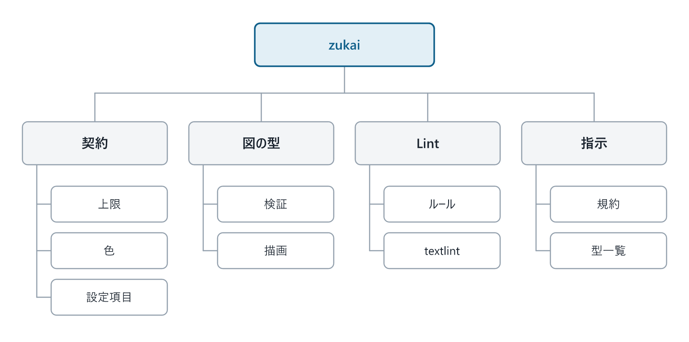
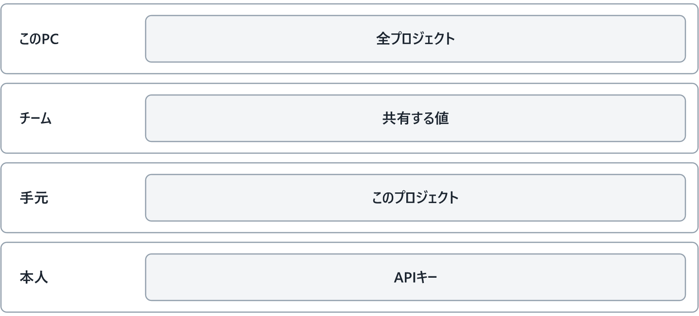
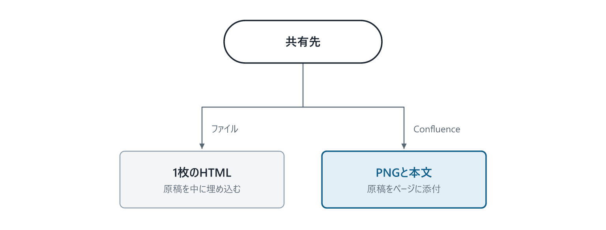
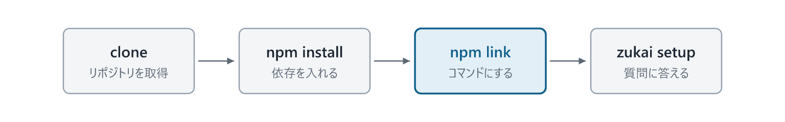
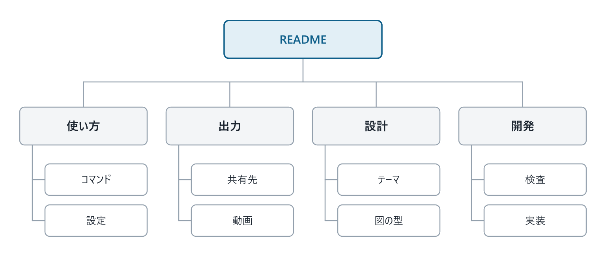

# zukai

zukai は、AI が書いた原稿から、図を中心にした日本語の資料を作るツールです。システムの設計書や社内の説明資料など、ブラウザで縦に読んでいくドキュメントを作れます。

AI に文章と図の内容を Markdown で書いてもらい、zukai で検査して HTML に変換します。作った資料は、HTML ファイルで渡したり、Confluence のページとして共有したりできます。

## 仕組み

資料は、原稿を書いて検査し、HTML に変換するという順で作ります。

1. AI が、見出し・文章・図の内容を Markdown の原稿に書く。図には、種類や箱の名前、要素どうしの関係を指定する。
2. `zukai lint` が、原稿の構成、図の項目数や文字の収まり、文章の書き方を検査する。検査に AI は使わない。
3. 検査で見つかった問題を直し、`zukai build` で HTML を作る。zukai が原稿の指定をもとに図を描き、本文と一緒に配置する。


図には、処理の流れや条件分岐など、内容に合った「型」を選べます。たとえば、手順を順番に説明するときは `flow`、複数の登場者のやり取りを示すときは `sequence` を使います。組み込みの型は 24 種類です。色やフォントを決める「テーマ」には、独自の型も追加できます。

文字数や図の要素数の上限、使う色、設定項目は「契約」として定義しています。AI に渡す指示と Lint の検査は、この定義と図の型を共通で使います。AI が書くときのルールと、zukai が検査するときのルールをそろえるためです。



AI には、最初に図の型の一覧を渡し、使う型が決まってから詳しい書き方を渡します。原稿と図の具体例は [docs/manuscript.md](docs/manuscript.md)、各部品の役割と置き場所は [docs/architecture.md](docs/architecture.md) にあります。

## 設定

設定は、どこまで共有したいかで置き場所を分けます。全プロジェクトの共通設定は「この PC」、プロジェクト内で共有する設定は「チーム」に置きます。「手元」には自分だけの変更、「本人」には API キーやトークンを保存します。



同じ項目に複数の値があるときは、図の下側にある設定が優先されます。環境変数で指定した値は、すべての設定ファイルより優先します。

たとえば、チームで資料と動画を出力する設定にしていても、手元の設定を変えれば、自分だけ資料の出力にできます。設定ファイルの場所や変更コマンドは [docs/configuration.md](docs/configuration.md) にあります。

## 共有

編集する原本は Markdown の原稿です。共有先に合わせて、原稿から次の形で資料を作ります。

- HTML で渡す場合は、図と本文を 1 つのファイルにまとめる。原稿も HTML の中に保存するので、受け取った人が取り出して編集できる。
- Confluence で共有する場合は、図を PNG として添付し、ページの本文から表示する。編集用の Markdown 原稿もページに添付する。



内容を直すときは、原稿を編集して資料を作り直します。Confluence への登録手順や、AI の返答を図解の資料として表示する方法は [docs/output.md](docs/output.md) にあります。

## はじめ方

Node.js 24 以上が必要です。zukai は npm に公開していないため、このリポジトリを取得して使います。`npm link` を実行すると、ほかのプロジェクトからも `zukai` コマンドを呼べるようになります。



```bash
git clone https://github.com/otomatty/zukai.git
cd zukai
npm install
npm link            # zukai コマンドを使えるようにする。フォルダを動かしたら、やり直す

cd /path/to/project
zukai setup         # 使う AI ツール、出力の形、共有先を質問に答えて設定する
```

`zukai setup` は、AI に資料作成の手順を教える「スキル」も設定します。セットアップ後は、選んだ AI ツールに「ログイン処理を図で説明して」のように依頼して資料を作れます。

手元に Markdown の原稿がある場合は、次のコマンドで検査し、HTML に変換できます。

```bash
zukai lint 原稿.md
zukai build 原稿.md  # 原稿.html を書き出す
```

コマンドを使わずに操作したいときは、`zukai gui` でブラウザの画面を開きます。AI が書いた資料の確認と書き出し、設定の変更、テーマの確認、Confluence への公開ができます。詳しくは [docs/output.md](docs/output.md#操作画面zukai-gui) にあります。

コマンドの一覧と詳しい設定手順は [docs/setup.md](docs/setup.md) にあります。`zukai` を使えない環境では、`node /path/to/zukai/src/cli.ts` の後ろにコマンド名と引数を書いて実行できます。

## ドキュメント

使い方や設計の詳細は、`docs/` にまとめています。原稿を書きたいとき、設定を変えたいとき、実装を調べたいときは、目的に合ったページを参照してください。



| ファイル | わかること |
|---|---|
| [docs/setup.md](docs/setup.md) | インストール、初期設定、コマンドの使い方 |
| [docs/configuration.md](docs/configuration.md) | 設定の置き場所、優先順位、変更方法 |
| [docs/manuscript.md](docs/manuscript.md) | 原稿の書き方と、図の型の選び方 |
| [docs/output.md](docs/output.md) | HTML や Confluence での共有と、AI の返答を資料にする方法 |
| [docs/video.md](docs/video.md) | 図解の資料から解説動画を作る方法 |
| [docs/theme.md](docs/theme.md) | 色やフォントの変更と、独自の図の型の追加 |
| [docs/lint.md](docs/lint.md) | 原稿の検査ルール、用語の統一、根拠の添え方 |
| [docs/architecture.md](docs/architecture.md) | 検査と描画を担う部品の役割、実装の置き場所 |
| [docs/development.md](docs/development.md) | 開発環境、テスト、Claude Code のプラグインとしての使い方 |

README の図も zukai で生成しています。原稿は `docs/diagrams/overview.md`、画像は `docs/images/` にあります。画像を作り直すには、次のコマンドを実行します。

```bash
zukai build docs/diagrams/overview.md --format=confluence
```

`docs/diagrams/overview.confluence/` に `fig-01.png` から `fig-06.png` が出ます。順に、原稿から資料を作る流れ、部品の役割、設定、共有先、はじめ方、ドキュメントの案内です。README に反映するときは、対応する画像を `docs/images/` にコピーします。
